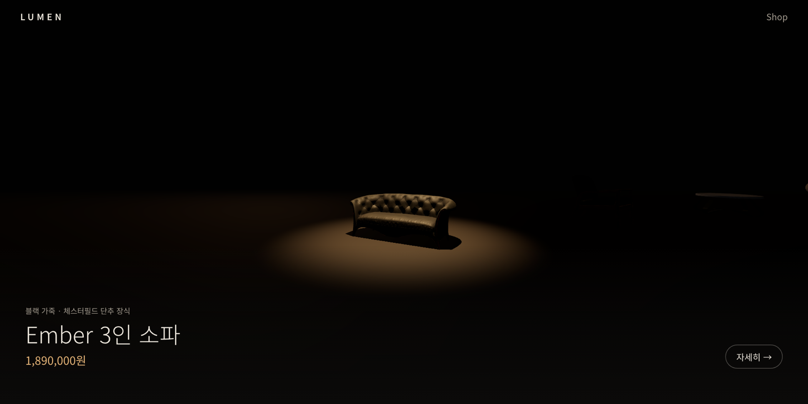
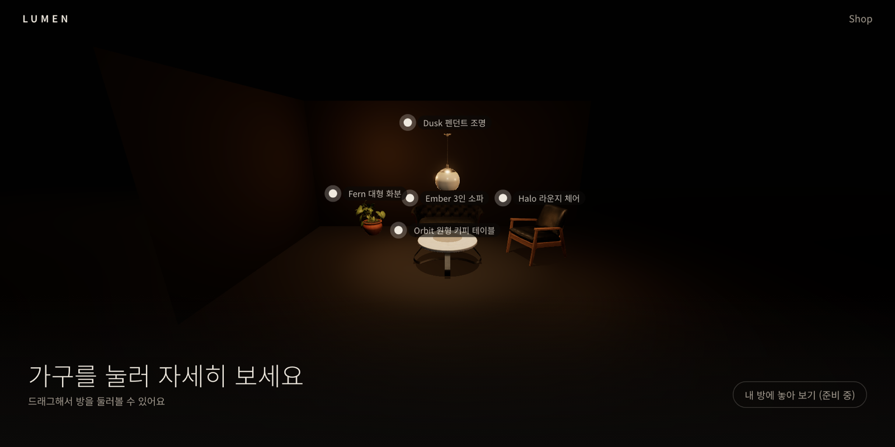
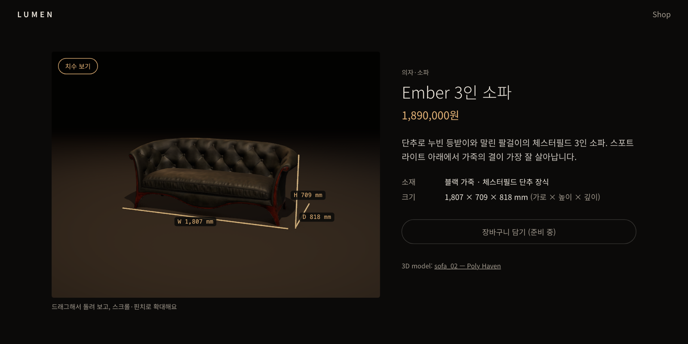
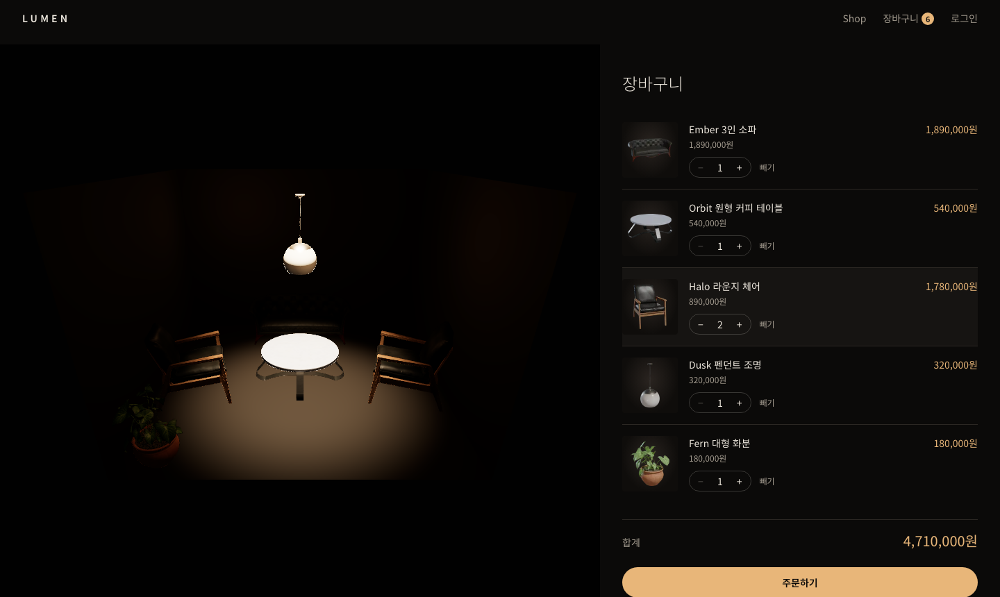
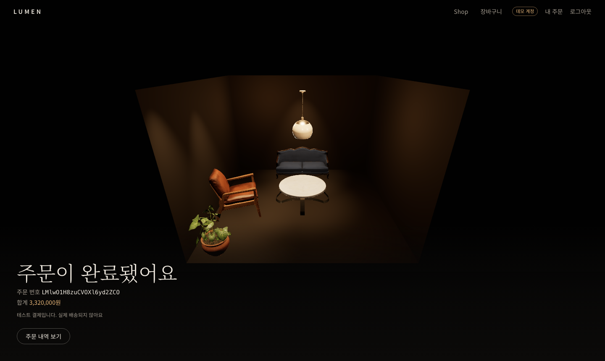
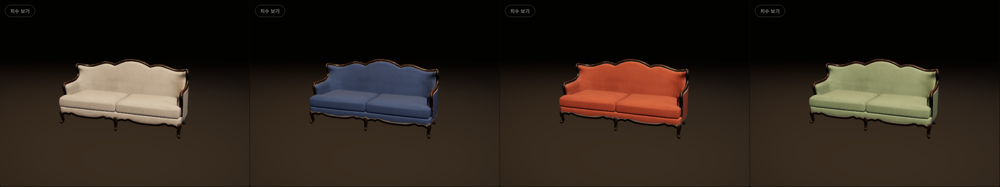
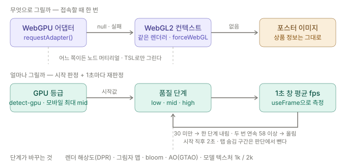
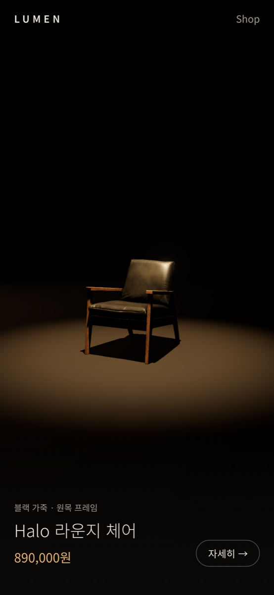
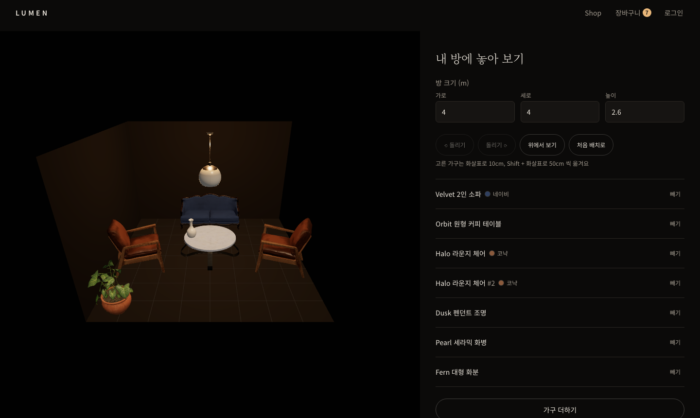

# LUMEN

어두운 쇼룸에서 조명 아래의 가구를 3D로 둘러보고, 색을 바꿔 보고, 내 방 크기에 놓아 본 뒤 결제까지 할 수 있는 가구 쇼핑몰입니다.

**https://lumen-showroom.vercel.app**



스크롤을 내리면 가구가 하나씩 스포트라이트 아래로 들어옵니다. 다섯 번째 가구가 지나가면 조명이 하나둘 켜지면서, 지금까지 본 가구들이 한 방에 놓인 모습이 드러납니다. 방을 돌려 보다가 가구를 누르면 상품 페이지로 넘어가고, 거기서는 가구를 360도로 돌려 보면서 실제 치수를 확인할 수 있습니다.

<p>
  
  
</p>

마음에 드는 가구는 3D 화면에서 바로 담습니다. 장바구니를 열면 담은 가구들이 한 방에 놓여 있고, 결제를 마치면 어두운 방에서 방금 산 가구 위로 불이 하나씩 켜집니다. 로그인 화면의 **데모 계정으로 체험하기**를 누르면 개인 계정 없이 결제 완료 장면까지 가 볼 수 있습니다. 결제는 토스페이먼츠 테스트 결제라 실제로 돈이 나가지 않습니다.

<p>
  
  
</p>

천이나 가죽을 씌운 가구는 상품 페이지에서 색을 고를 수 있고, 고른 색 그대로 담아 주문합니다. **내 방에 놓아 보기**에서는 방의 가로·세로·높이를 넣고, 담은 가구를 끌어 옮기고 돌려 가며 배치를 정합니다.



## 왜 만들었나

포트폴리오에 3D나 그래픽을 다루는 프로젝트가 하나도 없었습니다. 그래서 이 프로젝트로 "화려한 3D 사이트"를 하나 보여 주는 것보다 더 어려운 쪽을 목표로 잡았습니다. **어떤 기기로 열어도 버벅이지 않는 3D 쇼핑몰**입니다.

3D 사이트를 만드는 것 자체는 어렵지 않습니다. 어려운 건 그게 면접관의 5년 된 노트북에서도, 지하철에서 연 휴대폰에서도 똑같이 매끄러워야 한다는 점입니다. 쇼핑몰이라면 더 그렇습니다. 3D가 늦게 뜨거나 끊기면 사람들은 가구를 보기 전에 창을 닫습니다.

## 붙잡고 있던 문제들

### 1. 어떤 기기에서 열지 모른다

무엇으로 그릴지는 접속할 때 한 번 정합니다. WebGPU를 쓸 수 있으면 WebGPU로, 아니면 같은 렌더러를 WebGL2로 돌리고, 그것도 안 되면 3D 대신 이미지를 보여 줍니다. 이미지로 대체되더라도 가구 이름과 가격, 상세 링크는 그대로 읽힙니다.

렌더러를 둘 두지 않고 Three.js의 `WebGPURenderer` 하나로 통일한 데에는 대가가 있었습니다. 흔히 쓰는 GLSL 셰이더 기반 효과들을 쓸 수 없어서, 빛 번짐(bloom)과 그림자 깊이(AO)는 Three.js의 새 셰이더 언어(TSL)로 다시 붙였습니다. 상품 치수선도 처음에는 drei의 `Line`으로 그렸는데, 이게 WebGPU에서 깨진다는 걸 알고 얇은 막대 메시로 바꿨습니다.

얼마나 그릴지는 1초마다 다시 정합니다. 처음에는 GPU 등급으로 시작 품질을 고르고, 그 뒤로는 실제 프레임을 보면서 30fps 아래로 떨어지면 한 단계 내리고, 두 번 연속 58fps를 넘으면 한 단계 올립니다. 단계가 바뀌면 렌더 해상도, 그림자 품질, bloom, AO, 모델 텍스처 해상도(1k/2k)가 함께 바뀝니다.

여기서 한 번 크게 헛발질을 했습니다. 규칙을 붙이고 M1 맥북에서 열어 봤더니, 첫 화면부터 그림자도 빛 번짐도 없는 최저 품질로 떨어져 있었습니다. 화면 구석에 fps를 띄워 보니 첫 1초가 4fps였습니다. 셰이더를 컴파일하고 모델을 푸는 동안이었으니 기기가 느린 게 아니라 아직 준비 중이었던 겁니다. 탭을 숨겼다 돌아오는 순간도 같은 함정이었습니다. 프레임이 멈춰 있던 시간이 숫자로는 "엄청 느린 기기"로 보이니까요.

그래서 판단에 쓰는 측정부터 걸렀습니다. 시작 직후 2초와 1.5초보다 길게 늘어진 구간은 판단에서 빼고, 단계를 바꾼 뒤에는 이전 측정을 지웁니다. 이 규칙은 순수 함수로 떼어 테스트로 고정했습니다(`src/three/quality/policy.ts`). 그 뒤로 M1에서는 쇼룸 끝까지 최고 품질을 유지하고(평균 59.9fps), GPU가 없는 테스트 브라우저에서는 11fps가 나오자 최저 품질까지 알아서 내려갑니다.

GPU가 아예 없는 기기는 따로 다룹니다. 브라우저가 CPU로 그려 주는 소프트웨어 렌더러(SwiftShader 등) 덕분에 3D가 "켜지기는" 하지만, 최저 품질에서도 쇼룸이 7fps라 사진만 못합니다. 시작할 때 렌더러 이름이 소프트웨어면 3D 대신 사진을 보여 주고, 이름으로 못 잡은 기기도 최저 품질에서 4초 연속 10fps가 안 나오면 사진으로 바꿉니다. 한 번 포기하면 다른 페이지에서 다시 시도하지 않습니다. e2e는 바로 이 환경(GPU 없는 헤드리스 브라우저)에서 돌기 때문에, 기본이 사진인지를 테스트로 확인하고 3D 테스트는 렌더러를 직접 지정해 켭니다.



### 2. 3D가 첫 화면을 붙잡고 있었다

기능을 다 붙이고 Lighthouse를 모바일 조건으로 돌렸더니, 홈의 첫 화면이 다 뜨는 데(LCP) **16.2초**가 걸렸습니다. 메인 스레드가 막혀 있던 시간(TBT)은 9.7초였습니다. 실제 원인은 제목 글자가 아니라, 그 글자를 그리기도 전에 three.js 로드와 GPU 판정, 모델 디코딩이 메인 스레드를 차지하고 있던 것이었습니다.

3D 시작을 페이지 로드가 끝나고 브라우저가 한가해질 때(`requestIdleCallback`)까지 미뤘습니다. 어두운 연출이라 3D가 1초쯤 늦게 떠도 검은 배경 위에 제목이 먼저 보이는 게 오히려 자연스러웠습니다. LCP는 5.8초, TBT는 0.9초로 줄었습니다.

같은 측정에서 상품 상세 페이지의 레이아웃이 크게 흔들리는 것(CLS 0.373)도 찾았습니다. 3D 영역이 늦게 로드되면서 처음엔 자리를 안 차지하다가 갑자기 커지는 문제였고, 로딩 중에도 같은 크기의 자리를 잡아 두니 0.003이 됐습니다. 숫자와 측정 조건은 [`docs/perf/phase1.md`](docs/perf/phase1.md)에 남겼습니다.

### 3. 무료 3D 모델을 그대로 쓰지 않았다

가구 모델은 [Poly Haven](https://polyhaven.com)의 CC0 에셋입니다. API로 바로 받아 쓸 수도 있었지만, 원본은 텍스처가 커서 휴대폰에서 첫 화면이 한참 늦어집니다.

그래서 빌드 전에 스크립트(`npm run assets`)가 원본을 받아 `glTF-Transform`으로 줄입니다. 중복 데이터를 정리하고, 텍스처를 WebP로 바꾸고, 메시를 meshopt로 압축해 저화질(1k)·고화질(2k) 두 벌을 만듭니다. 20개 모델이 합쳐 33MB이고, 처음에 받는 저화질본은 모두 2MB 아래입니다. 캔들 홀더 하나만 2.06MB가 나와서 그 모델만 텍스처를 한 번 더 줄였습니다. 화면에는 항상 저화질본을 먼저 그리고, 기기가 감당할 수 있으면 고화질로 바꿔 끼웁니다.

### 작게 걸렸던 것들

- 천장 조명 모델은 원점이 위쪽에 있어서 바닥에 묻혀 보였습니다. 모델을 불러올 때 바운딩 박스로 바닥 위 가운데에 다시 놓습니다.
- 휴대폰에서 방을 손으로 돌릴 수 있게 하면 손가락이 페이지 스크롤을 못 합니다. 터치 기기에서는 카메라가 천천히 혼자 돌고, 가구 이름표를 탭하게 했습니다.
- 없는 상품 주소가 404가 아니라 200으로 나갔습니다. Next.js 16의 Cache Components에서는 페이지 안에서 `notFound()`를 불러도 이미 응답이 시작된 뒤라서, 렌더링 전에 Proxy에서 거릅니다.
- 시스템 설정에서 "동작 줄이기"를 켜면 자동 회전과 전환 애니메이션이 멈춥니다.



## 둘러보기에서 구매까지

2차의 목표는 결제 기능 자체보다 **3D로 본 경험이 구매까지 끊기지 않고 이어지는 것**이었습니다. 결제를 탄탄하게 만드는 일은 다른 프로젝트(Nextour)에서 2단계 결제와 환불까지 깊게 다뤄 봤습니다. 그래서 여기서 같은 이야기를 반복하지 않고, 면접관이 1~2분 안에 "보고, 담고, 내 방에서 보고, 결제하면 불이 켜진다"는 흐름을 끝까지 따라가 볼 수 있게 하는 데 집중했습니다.

### 4. 장바구니를 목록이 아니라 방으로

장바구니 화면 왼쪽에는 담은 가구가 놓인 방이 있고, 오른쪽에는 목록이 있습니다. 목록의 줄에 마우스를 올리면 방에서 그 가구에만 조명이 떨어지고, 방에서 가구를 누르면 목록의 그 줄이 강조됩니다.

무엇을 몇 개 담을지 모르니 배치는 규칙으로 정했습니다. 소파와 선반은 벽에 등을 붙이고, 테이블은 가운데에, 의자는 테이블 주변에, 펜던트 조명은 테이블 위 천장에, 화병은 테이블이나 선반 위에 놓습니다. 크기는 상품의 실제 치수로 계산해서 서로 겹치지 않게 하고, 자리가 모자라면 방을 0.5m씩 넓힙니다. 이 배치는 장바구니를 넣으면 방 크기와 가구 위치가 나오는 순수 함수라서, 같은 장바구니는 언제나 같은 방이 됩니다. 처음 결과를 찍어 봤더니 소파 하나가 뒷벽 왼쪽 끝에 붙어 있어 어색했습니다. 그래서 벽에 붙는 줄을 가운데로 모으는 규칙을 하나 더 넣었습니다.

방을 처음 채워 보다가 1차의 버그도 찾았습니다. 쇼룸에서는 가구를 하나씩 따로 보여 줘서 눈에 띄지 않았는데, 한 방에 모아 놓고 모델마다 바운딩 박스를 재 보니 Loft 스틸 선반의 원본 모델이 높이 21m로 실제의 10배였습니다. Grid 수납 선반은 90도 돌아가 있었습니다. 모델을 불러올 때 상품 치수와 실제 바운딩 박스를 비교해서 크기와 방향을 자동으로 맞추게 했고(`fitTransform`), 쇼룸과 상세 페이지에도 같이 적용했습니다.

### 5. 면접관이 개인 계정으로 로그인하지 않아도 되게

카카오와 구글 로그인을 붙였지만, 면접관이 포트폴리오를 보려고 자기 카카오 계정으로 로그인할 가능성은 낮다고 봤습니다. 그래서 로그인 화면 맨 위에 **데모 계정으로 체험하기** 버튼을 두었습니다.

공용 데모 계정 하나를 두면 여러 사람의 장바구니와 주문이 한 계정에 섞입니다. 그래서 버튼을 누를 때마다 그 브라우저 전용 임시 계정을 만들고, 만든 지 24시간이 지난 데모 계정은 새 데모 계정이 만들어질 때 장바구니, 주문과 함께 지웁니다.

로그인 전에 담은 가구는 브라우저에만 저장합니다. 그래야 쇼룸과 상품 페이지가 1차처럼 정적인 페이지로 빠르게 뜹니다. 로그인하는 순간 브라우저 장바구니를 서버 장바구니와 합칩니다.

### 6. 돈이 틀리면 안 된다

테스트 결제라도 금액이 틀리는 건 쇼핑몰에서 가장 큰 결함이라고 봤습니다. 브라우저가 보낸 가격은 믿지 않고, 주문할 때 서버가 상품 목록 기준으로 합계를 다시 계산해서 주문을 만듭니다. 토스에서 돌아왔을 때 금액이 저장해 둔 합계와 다르면 승인하지 않고 주문을 실패로 돌립니다. 승인 요청에는 주문 번호를 멱등 키로 붙이고, 이미 결제된 주문이면 승인을 다시 부르지 않습니다. 그래서 완료 화면에서 새로고침하거나 뒤로 가기를 해도 결제는 한 번만 됩니다. 결제가 끝나면 장바구니를 통째로 비우지 않고 **주문한 수량만큼만** 뺍니다. 결제창이 열려 있는 동안 다른 탭에서 담은 가구가 사라지면 안 되니까요.

### 7. 실제로 잡은 문제들

- **장바구니가 가끔 비었습니다.** 로그인 직후 서버 장바구니를 불러오는 요청이, 그 사이에 담은 요청보다 늦게 도착하면 담은 것을 덮어썼습니다. 여러 요청이 오가더라도 가장 마지막에 보낸 요청의 결과만 화면에 반영하게 했습니다.
- **수량을 바꾸면 목록 순서가 바뀌었습니다.** 목록을 '수정된 시각' 순으로 정렬했기 때문이었습니다. 담은 시각을 따로 저장하고 그 순서로 보여 줍니다.
- **담기를 한 번 눌렀는데 소파가 두 개 들어갔습니다.** 전체 테스트를 돌릴 때 결제 테스트가 가끔 합계가 틀려 실패해서 따라가 봤습니다. 로그인된 채로 페이지를 열면 세션을 확인하는 0.1~0.3초 동안 앱이 로그인 전으로 판단하고, 그때 누른 담기는 브라우저 장바구니에 들어갑니다. 곧바로 서버 장바구니와 합치는데, 그 응답이 오기 전에 페이지를 옮기면 다음 페이지에서 한 번 더 합쳐졌습니다. 세션 응답을 일부러 늦추는 테스트로 재현한 뒤, 로그인 여부가 정해지기 전에는 담기 버튼을 잠갔습니다.
- **위의 잠금으로도 남는 틈이 하나 있었습니다.** 로그인 전에 담아 둔 가구를 서버와 합칠 때, 서버는 처리했는데 응답만 끊기면 브라우저는 합쳐진 줄 모르고 다음에 다시 보냈습니다. 합치기는 수량을 '지정'이 아니라 '더하기'라서 그대로 두 배가 됐습니다. 브라우저 장바구니에 내용마다 번호를 붙이고, 서버는 그 번호를 먼저 적은 뒤 이미 받은 번호면 더하지 않게 했습니다. 번호 기록과 더하기를 한 트랜잭션에 넣어서, 탭 두 개가 동시에 보내도 한 번만 반영됩니다. 응답만 일부러 끊는 테스트를 만들어 고치기 전에는 소파가 2개, 고친 뒤에는 1개인 것을 확인했습니다.
- **Lighthouse가 상품 페이지 LCP를 5.1초라고 했지만, 실제로는 0.5초에 그려지고 있었습니다.** CPU를 4배 느리게 하고 직접 재 보니 가장 큰 글자는 536ms에 그려졌고, Lighthouse가 관찰한 값도 매번 첫 페인트와 같았습니다. 5.1초는 시뮬레이터가 "첫 페인트 전에 요청된 JS"를 느린 4G로 다시 계산한 추정치였습니다. 숫자를 그대로 믿고 포스터 이미지부터 붙였다면 엉뚱한 곳을 고쳤을 겁니다. 다만 그 과정에서 진짜 문제를 하나 찾았습니다. 3D 초기화는 load 뒤로 미뤘는데, 407KB짜리 three.js 파일을 받는 것은 그보다 먼저 시작하고 있었습니다. 받는 시점도 load 뒤로 옮겼습니다.
- **테스트는 다 통과했는데 운영에서 첫 결제가 실패했습니다.** 토스 승인 API가 `403 API_KEY_ACCESS_DENIED`를 돌려줬습니다. 로그를 보니 토스 상점에 '대한민국 IP만 허용'하는 API 키 접근 정책이 걸려 있었습니다. 그런데 LUMEN의 서버 함수는 DB가 있는 싱가포르에서 돌아갑니다. 로컬과 e2e 테스트는 결제 시뮬레이션으로 돌기 때문에 운영에 올리기 전까지는 알 수 없었던 문제였습니다. 카카오 로그인도 운영에서 처음 눌렀을 때 리다이렉트 주소가 등록되어 있지 않아 막혔습니다. 외부 서비스와 맞닿는 부분은 운영에서 직접 끝까지 눌러 보기 전까지 끝난 게 아니라는 걸 배웠습니다.

## 직접 만져 보고 고르기

3차의 목표는 면접관이 3D를 보기만 하는 게 아니라 **직접 만져 보고 결정하는 것**이었습니다. 이번에는 세부 판단을 처음부터 Claude에게 맡겼고, 그래서 결정마다 이유를 설계 문서에 더 꼼꼼히 남기게 했습니다.

### 8. 텍스처 한 장에서 천만 다시 칠하기

1차 설계 때부터 "모델마다 다르니 해 봐야 안다"고 미뤄 둔 기능입니다. 설계 전에 먼저 모델 20개의 재질을 열어 봤는데, 14개가 재질 하나에 텍스처 한 장이었습니다. 천과 나무 다리가 한 장의 그림에 같이 그려져 있으니, "천 부분만 다른 소재로 바꾸기"는 대부분의 모델에서 불가능했습니다. 재질 전체에 색을 곱하면 쉽지만 조각된 나무 프레임까지 물듭니다.

그래서 셰이더에서 텍스처의 점 하나하나가 천의 대표색에 얼마나 가까운지를 재고, 가까운 점만 새 색으로 칠했습니다. 원래 밝기 비율은 그대로 곱해서 천의 결과 주름, 그늘이 남게 했습니다. 대표색은 텍스처를 네 가지 색으로 묶어 가장 넓은 묶음에서 잡았습니다. 위 사진의 Velvet 소파는 프레임은 그대로 두고 천만 바뀝니다.

모든 색을 실제 3D로 찍어 보면서 값을 맞췄습니다. 거의 검은 가죽인 Halo 체어는 처음에 코냑색이 크림색처럼 떴습니다. 원래 텍스처의 밝은 점이 어두운 대표색보다 몇 배나 밝아서, 밝기 비율을 곱하면 그만큼 부풀었기 때문입니다. 목표색을 어둡게 잡아 자연스러운 가죽색으로 맞췄습니다. 색을 바꿔도 모델을 다시 받지 않고 재질만 갈아 끼우기 때문에 바로 바뀝니다.

### 9. 고른 색이 주문까지 따라가게

색을 미리보기로만 두면 마이그레이션 없이 끝나지만, "고른 색을 산다"가 안 됩니다. 장바구니와 주문의 한 줄을 (상품, 색)으로 바꿨습니다. 같은 소파를 네이비와 아이보리로 담으면 두 줄이 되고, 담기·수량·빼기·로그인 순간 합치기·끊긴 요청 다시 보내기가 모두 `상품|색` 열쇠 하나를 씁니다. 색도 가격처럼 서버가 다시 확인해서 카탈로그에 없는 색은 원래 색으로 담습니다.

DB 마이그레이션은 열을 더하고 기본키만 바꾸게 짜서, 기존 장바구니가 그대로 남고 옛 코드도 새 열을 몰라도 돌아가게 했습니다. 그래서 운영 DB에 먼저 적용하고 코드를 배포하는 순서로, 서비스를 멈추지 않고 올릴 수 있습니다. 만드는 동안 테스트가 잡아 준 실수도 있습니다. 결제 승인 코드가 색을 넘기지 않아서, 네이비를 샀는데 결제하는 사이에 담은 원래 색 소파가 장바구니에서 빠지는 일이었습니다.

### 10. 내 방에 놓아 보기

방은 장바구니로 만듭니다. 2차에서 만든 자동 배치를 시작점으로 쓰되, 여기서는 사용자가 넣은 크기가 정답이라 방을 넓히지 않고 남는 가구를 가운데에 둡니다. 가구를 누르면 그 순간부터 마우스 위치를 바닥 평면에 레이로 쏴서 끌고, 5cm 단위로 맞추고, 돌린 상태의 크기로 벽 안에 가둡니다. 겹치면 붉게 표시만 하고 막지는 않습니다. 화병은 탁자 위에 놓으면 상판 높이에 올라갑니다. 배치 계산은 모두 화면과 떼어 순수 함수로 만들고 테스트로 고정했습니다(`src/room/planner.ts`).

마우스 없이도 화살표와 Q·E 키로 옮기고 돌릴 수 있습니다. 접근성을 위한 것이기도 하지만, 3D 화면의 좌표는 시점마다 달라서 e2e 테스트도 이 길로 위치를 잽니다. 휴대폰에서는 캔버스 위 손가락이 페이지를 스크롤하지 않고 가구를 끌거나 시점을 돌립니다.



## AI와 어떻게 나눠 일했나

구현은 Claude Code가 했습니다. 저는 무엇을 왜 만들지와 어떤 기술로 갈지를 정하고, 결과를 실제 기기에서 확인했습니다. 3D 가구 쇼핑몰이라는 주제, 다크 시네마틱한 분위기, Three.js와 React Three Fiber를 쓰고 기기 성능에 맞춰 품질을 조절해야 한다는 요구, 세 단계로 나눠 빨리 올린다는 순서, 그리고 이름이 제 몫이었습니다. 2차에서는 "결제 기능이 아니라 3D 경험이 구매까지 이어지는 걸 보여 준다"는 방향, 장바구니를 방과 목록으로 나누는 화면, 데모 계정을 두는 것을 제가 정했습니다.

나머지 세부 판단은 Claude가 했고, 그 판단을 모두 기록으로 남기게 했습니다. 가구 자동 배치 규칙, 브라우저마다 따로 만드는 데모 계정, 서버 함수를 싱가포르에 두는 것 같은 결정이 여기에 들어갑니다. 3차는 세부 판단을 통째로 맡겼고, 색 바꾸기 방식을 정하기 전에 먼저 시험해 보게 한 것도 그래서입니다.
- **설계 문서** 1차 [`lumen-design.md`](docs/superpowers/specs/2026-11-02-lumen-design.md) · 2차 [`lumen-phase2-design.md`](docs/superpowers/specs/2026-11-02-lumen-phase2-design.md) · 3차 [`lumen-phase3-design.md`](docs/superpowers/specs/2026-11-04-lumen-phase3-design.md): 마지막 장에 "Claude가 정한 것"을 따로 적어 두었습니다.
- **구현 계획** 1차 [`phase1-showroom.md`](docs/superpowers/plans/2026-11-02-phase1-showroom.md) · 2차 [`phase2-commerce.md`](docs/superpowers/plans/2026-11-02-phase2-commerce.md) · 3차 [`phase3-color-room.md`](docs/superpowers/plans/2026-11-04-phase3-color-room.md): 각각 11 · 12 · 7단계로 나눴고, 단계마다 먼저 실패하는 테스트를 쓰고 나서 구현했습니다.

만드는 동안 문제를 가장 많이 잡아낸 건 테스트가 아니라 스크린샷이었습니다. 테스트가 다 통과해도 화면을 찍어 보면 천장 조명이 바닥에 묻혀 있었고, 가구 이름표가 서로 겹쳐 있었고, 처음 지어 둔 상품 설명이 실제 모델과 달랐습니다. 검은 가죽 소파를 "브라운 패브릭"이라고 써 놓은 식이었습니다.

## 실행

```bash
npm install
npm run dev
```

- `?debug`를 붙이면 화면 오른쪽 위에 렌더러 종류, 품질 단계, fps가 나옵니다.
- `?tier=0|1|2`로 품질을 고정하고, `?adaptive=off`로 자동 조절을 끕니다.
- `?renderer=webgl2|none`으로 렌더러를 강제로 바꿀 수 있습니다.
- 로그인과 장바구니, 결제는 DB(Postgres)가 필요합니다. `.env.local`에 `DATABASE_URL`, `AUTH_SECRET`, 그리고 `PAYMENT_SIMULATION=true`를 넣으면 토스 결제창 없이 결제 흐름을 끝까지 돌려 볼 수 있습니다. 시뮬레이션은 운영 환경에서는 켜지지 않습니다.
- 검사는 `npm run check`(lint · 타입 · 단위 테스트 109개), `npm run test:db`(DB 통합 테스트 28개), `npm run test:e2e`(Playwright 75개)입니다.

**스택** Next.js 16 · React 19 · TypeScript · three.js 0.187(WebGPURenderer, TSL) · React Three Fiber 9 · drei · zustand · Tailwind CSS 4 · Auth.js 5 · Prisma 7 · Neon Postgres · 토스페이먼츠 · Vitest · Playwright · Vercel

## 아직 남은 것

- **색 바꾸기의 한계:** 천과 다리가 둘 다 어두운 Ember 소파는 다리까지 조금 물들고, 무늬 천인 Siesta 데이베드는 등받이 줄무늬도 살짝 물듭니다. 장바구니 목록의 썸네일은 사진이라 원래 색으로 보이고, 색 이름으로 구분합니다.
- **내 방:** 회전은 90° 단위이고 벽·창문은 그리지 않습니다. 배치는 브라우저에만 저장됩니다.
- **측정:** 맥북과 삼성 휴대폰에서 매끄럽게 도는 건 확인했지만, 저사양 노트북 실기기로는 아직 재지 못했습니다.

3D 모델 · 텍스처 · 조명 배경은 [Poly Haven](https://polyhaven.com)(CC0)에서 가져왔습니다. 상품 이름과 가격, 설명은 지어낸 것입니다.
